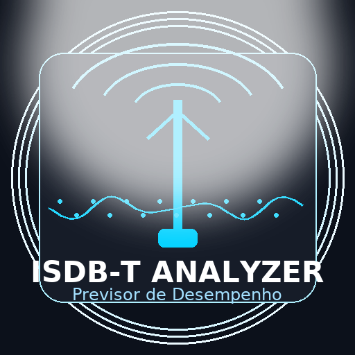
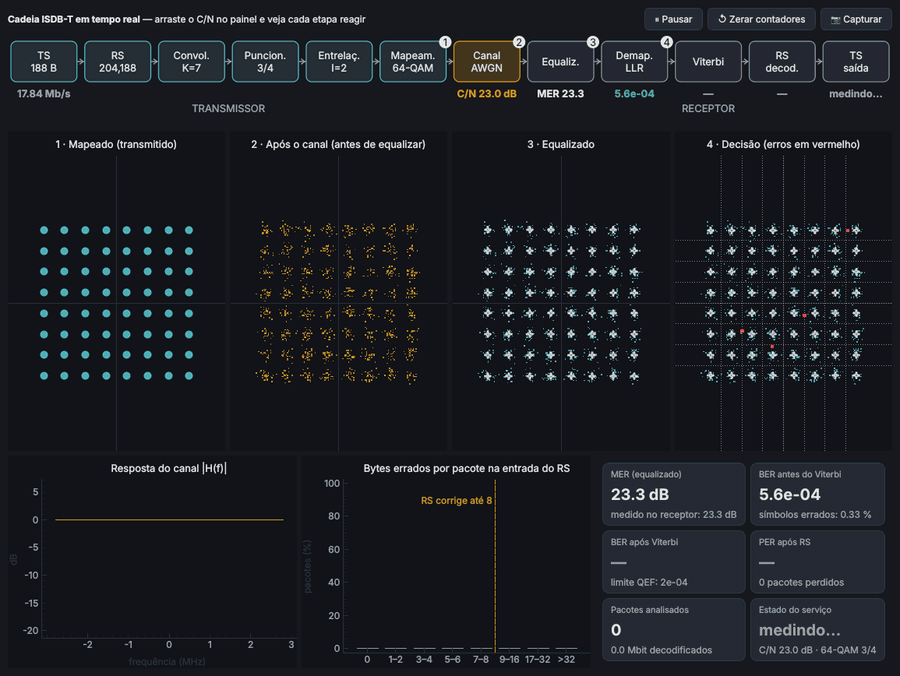
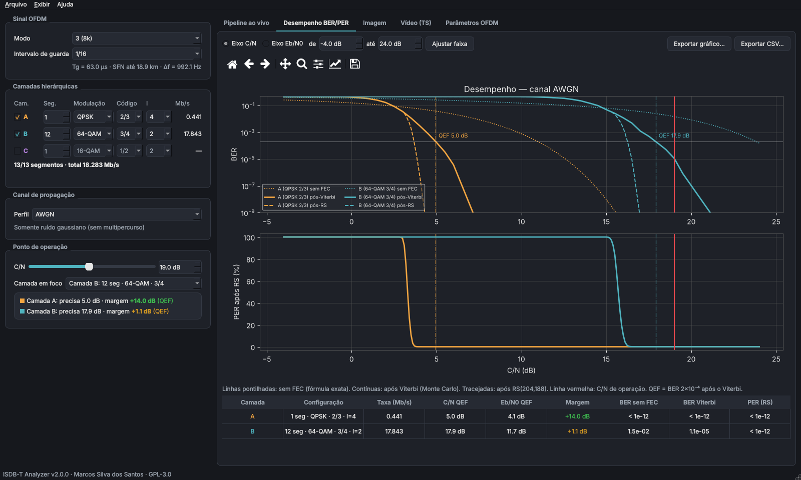
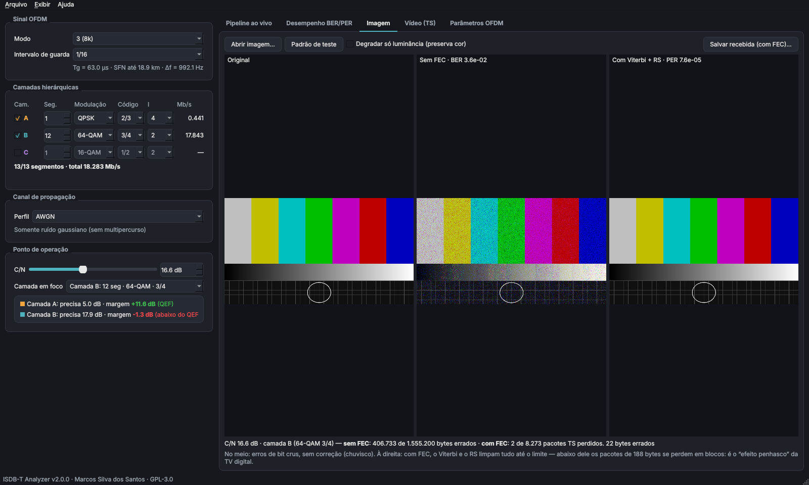
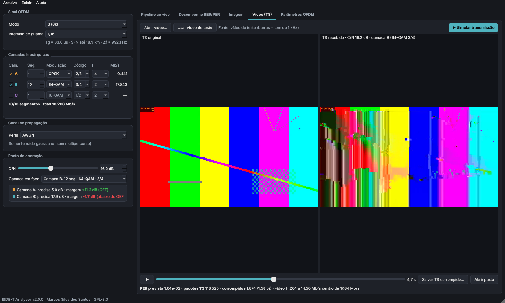
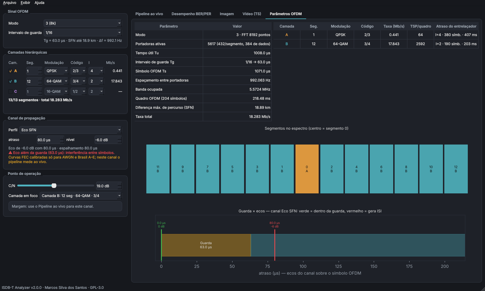

<h1 align="center">
  <br>
  ISDB-T Analyzer
</h1>

<p align="center">
Previsão de desempenho e simulação didática do <b>ISDB-T / ISDB-Tb</b> para Linux.<br>
Mostra camadas hierárquicas, BER/PER com Viterbi e Reed-Solomon de verdade, constelações de cada etapa em
tempo real, perfis de canal Brasil A–E, eco SFN e vídeo transmitido em Transport Stream.
</p>

<p align="center">
  <a href="https://github.com/aragonxpd154/ISDBT-Analyzer/actions/workflows/ci.yml"></a>
  
  
  
  
</p>

<p align="center">
  <a href="#-funcionalidades">Funcionalidades</a> ·
  <a href="#-instalação">Instalação</a> ·
  <a href="#-como-usar">Como usar</a> ·
  <a href="#-modelo-e-validação">Modelo e validação</a> ·
  <a href="#-desenvolvimento">Desenvolvimento</a> ·
  <a href="#-licença">Licença</a>
</p>



## ✨ Funcionalidades

| Aba | O que faz |
|---|---|
| **Pipeline ao vivo** | Diagrama de blocos TX → canal → RX com a métrica de cada etapa e **quatro constelações em tempo real**: mapeado, após o canal, equalizado e decisão com os erros em vermelho. Mostra também a resposta \|H(f)\|, o histograma de bytes errados por pacote na entrada do RS e os contadores de **MER, BER antes e depois do Viterbi, PER e estado do serviço**. Tudo reage enquanto você arrasta o C/N. |
| **Desempenho BER/PER** | Para cada camada: curvas **sem FEC** (fórmula exata), **após o Viterbi** (Monte Carlo) e **após o RS(204,188)**, a PER com o efeito penhasco e o **C/N mínimo (QEF)**, com a margem em relação ao ponto de operação. Eixo em C/N ou Eb/N0. Exporta PNG, SVG, PDF e CSV. |
| **Imagem** | Original, sem FEC (chuvisco de bits) e com Viterbi + RS (perda de pacotes de 188 bytes), lado a lado. |
| **Vídeo (TS)** | Codifica o vídeo em **H.264/AAC num MPEG-TS** na taxa da camada. Corrompe os pacotes conforme a PER (marcando o bit TEI) e decodifica com o FFmpeg, mostrando **macroblocos e congelamentos reais**. O `.ts` corrompido pode ser salvo (abre no VLC ou num analisador de TS). |
| **Parâmetros OFDM** | Tu, Tg, Δf, banda ocupada, quadro, TSP por quadro, atraso do entrelaçador, **distância máxima de SFN**, mapa dos 13 segmentos e diagrama **guarda × ecos** (o eco que passa da guarda fica vermelho). |

Outros recursos:

- **Camadas hierárquicas A/B/C**, com segmentos, modulação (QPSK, 16-QAM, 64-QAM), código (1/2 a 7/8) e entrelaçamento temporal I. Os modos 1, 2 e 3 e as guardas de 1/4 a 1/32 estão disponíveis.
- **Canais**: AWGN, **Brasil A, B, C, D e E**, e **eco SFN** com atraso e nível ajustáveis.
- **Relatório PDF** em três páginas (parâmetros, curvas e constelações), além de configurações salvas em JSON.
- **Linha de comando** completa, para usar em scripts e planilhas.
- Tema escuro ou claro, telas de alta resolução, e janela e preferências lembradas.

<p align="center">
  
  
  
  
</p>

## 📦 Instalação

Feito para Ubuntu e derivados (Zorin OS, Linux Mint, Pop!\_OS) e testado no Ubuntu 24.04. Requer Python 3.10 ou mais novo.

```bash
git clone https://github.com/aragonxpd154/ISDBT-Analyzer.git
cd ISDBT-Analyzer
./install.sh
```

O instalador:

1. Confere o Python e oferece instalar, com `sudo apt`, o que faltar no sistema: `python3-venv`,
   `libxcb-cursor0` (exigido pelo Qt 6.5+ no X11) e `ffmpeg`.
2. Cria um ambiente virtual próprio em `~/.local/share/isdbt-analyzer/venv`, sem mexer no Python do sistema.
3. Instala o programa e as dependências.
4. Cria o comando `isdbt-analyzer` e o atalho **ISDB-T Analyzer** no menu de aplicativos.

Opções: `./install.sh -y` instala sem perguntar, `--sem-sudo` não instala pacotes do sistema e `--dev` instala
em modo editável com pytest e ruff. Para remover: `./uninstall.sh`.

<details>
<summary>Instalação manual com pip</summary>

```bash
python3 -m venv .venv && source .venv/bin/activate
pip install .
isdbt-analyzer
```
</details>

> **A janela não abre e aparece o erro "Could not load the Qt platform plugin xcb"?**
> Instale `sudo apt install libxcb-cursor0`.
> Se você tiver o `opencv-python` comum instalado no mesmo ambiente, troque-o pelo `opencv-python-headless`.

## 🚀 Como usar

### Interface gráfica

Abra pelo menu ou rode `isdbt-analyzer`. No painel da esquerda:

1. Escolha o **modo** e o **intervalo de guarda**.
2. Configure as **camadas A/B/C**. O padrão é a configuração típica brasileira: A = 1 seg QPSK 2/3 (one-seg)
   e B = 12 seg 64-QAM 3/4.
3. Escolha o **canal** (AWGN, Brasil A–E ou eco SFN).
4. Arraste o **C/N**. Todas as abas acompanham, e o painel mostra a margem de cada camada até o QEF.

Atalhos: `Ctrl+O` e `Ctrl+S` abrem e salvam a configuração, e `Ctrl+E` exporta o relatório PDF.

### Linha de comando

```bash
# Taxas e parâmetros OFDM
isdbt-analyzer taxa --modo 3 --guarda 1/16 -c A:1:QPSK:2/3:4 -c B:12:64QAM:3/4:2

# C/N mínimo (QEF), margem e PER num ponto de operação
isdbt-analyzer desempenho -c A:1:QPSK:2/3:4 -c B:12:64QAM:3/4:2 --canal "Brasil A" --cn 21

# Curvas em CSV (separador ;) e relatório em PDF
isdbt-analyzer curvas -c B:12:64QAM:3/4 --de 10 --ate 25 -o curvas.csv
isdbt-analyzer relatorio -c A:1:QPSK:2/3:4 -c B:12:64QAM:3/4:2 --cn 20 -o relatorio.pdf

# Imagem e vídeo
isdbt-analyzer imagem foto.jpg -c B:12:64QAM:3/4 --cn 16.5 -o recebida.png
isdbt-analyzer video entrada.mp4 -c B:12:64QAM:3/4 --cn 16.8 -o simulacao/
```

As camadas usam o formato `NOME:SEGMENTOS:MODULAÇÃO:CÓDIGO[:I]`. Veja `isdbt-analyzer --help`.

## 🔬 Modelo e validação

```
TS 188 B → RS(204,188) → convolucional K=7 (171,133) → puncionamento → entrelaçadores → QAM Gray
        → canal (multipercurso + ruído) → equalização → LLR max-log → Viterbi soft → RS → TS
```

- **C/N** = Es/N0 nas portadoras de dados, com estimação de canal perfeita.
- **BER sem FEC**: fórmula exata do QAM com código Gray por eixo, somando sobre as regiões de decisão. No
  multipercurso, a fórmula é aplicada portadora a portadora e depois tirada a média.
- **BER após o Viterbi**: medida por **Monte Carlo** com o código e os puncionamentos da norma e entrelaçamento
  de bits ideal. As tabelas ficam em `resources/fec_tables.json` e podem ser refeitas com
  `isdbt-analyzer calibrar`.
- **RS(204,188)**: o pacote falha quando chegam mais de 8 bytes errados. O cálculo supõe entrelaçamento de
  bytes ideal.
- **QEF** (*quasi error free*): BER = 2×10⁻⁴ após o Viterbi.
- **Taxas**: calculadas exatamente pela estrutura de quadro, sem ajustes. Batem com as tabelas da
  ABNT NBR 15601; por exemplo, 13 seg 64-QAM 3/4 GI 1/8 dá 18,255 Mb/s.

**C/N para QEF em AWGN**, comparado com os valores de referência da literatura DVB-T/ISDB-T (mesmo código
interno e mesmos mapeamentos):

| | 1/2 | 2/3 | 3/4 | 5/6 | 7/8 |
|---|---|---|---|---|---|
| **QPSK** — este programa | 3,2 | 5,0 | 5,9 | 6,9 | 7,6 |
| QPSK — referência | 3,1 | 4,9 | 5,9 | 6,9 | 7,7 |
| **16-QAM** — este programa | 8,9 | 11,1 | 12,2 | 13,4 | 13,9 |
| 16-QAM — referência | 8,8 | 11,1 | 12,5 | 13,5 | 13,9 |
| **64-QAM** — este programa | 13,8 | 16,6 | 17,9 | 19,1 | 19,8 |
| 64-QAM — referência | 14,4 | 16,5 | 18,0 | 19,3 | 20,1 |

A suíte de testes falha se algum valor se afastar mais de 0,75 dB da referência.

**Limitações.** O canal é estático: não há Doppler nem desvanecimento variável no tempo, e o entrelaçamento
temporal só aparece como atraso. A estimação de canal é perfeita. O sinal TMCC/AC e os pilotos não entram na
potência. Os perfis Brasil A–E seguem os valores mais citados na literatura, mas há publicações com pequenas
divergências; os valores estão em `core/channel.py` para conferência.

## 🛠 Desenvolvimento

```bash
./install.sh --dev                     # ou: pip install -e ".[dev]"
pytest                                 # testes (inclui teste da interface sem tela)
ruff check src tests                   # estilo
isdbt-analyzer calibrar                # refaz as tabelas de FEC (≈ 20 min em 2 núcleos)
```

```
src/isdbt_analyzer/
├── core/                 # cálculo, sem dependência de interface
│   ├── params.py         # constantes da norma (modos, guardas, puncionamentos)
│   ├── ofdm.py           # camadas, tempos e taxas
│   ├── modulation.py     # QAM Gray, LLR, BER exata, MER
│   ├── channel.py        # AWGN, Brasil A–E, eco SFN, ISI
│   ├── fec.py            # convolucional + Viterbi em lote + RS
│   ├── tables.py         # curvas Monte Carlo (calibração e interpolação)
│   ├── analysis.py       # QEF, margens, gráficos, CSV
│   ├── media.py          # degradação de imagens
│   ├── video.py          # simulação em MPEG-TS com FFmpeg
│   └── report.py         # relatório PDF
├── gui/                  # interface PySide6 + pyqtgraph
└── cli.py                # linha de comando
```

O histórico de mudanças e os erros de cálculo corrigidos desde a v1 estão em [CHANGELOG.md](CHANGELOG.md).

## 📝 Licença

Distribuído sob a **GPL-3.0**. Veja [LICENSE](LICENSE).
© Marcos Silva dos Santos — ObelLab · <https://www.obellab.com.br>
